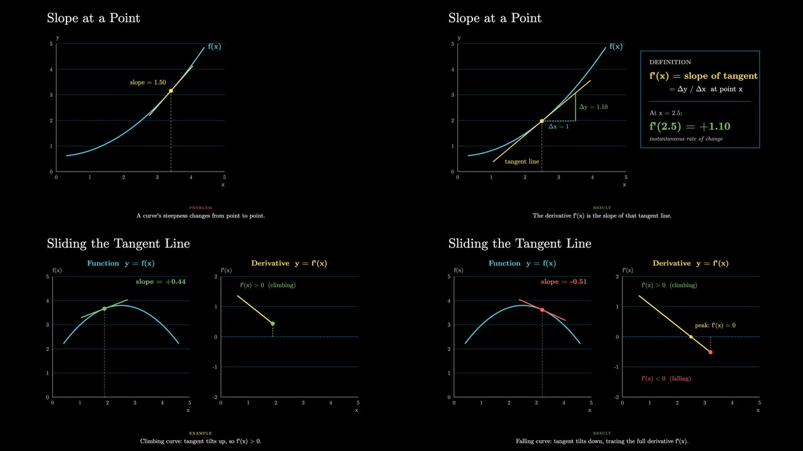
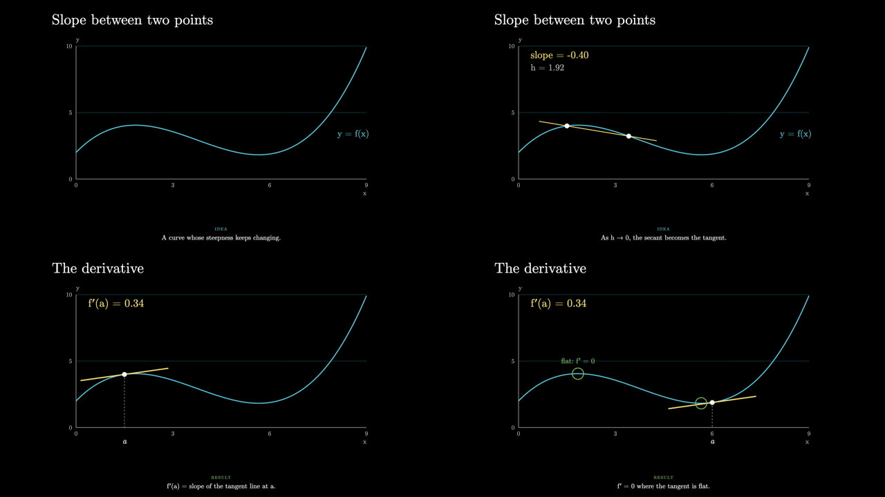
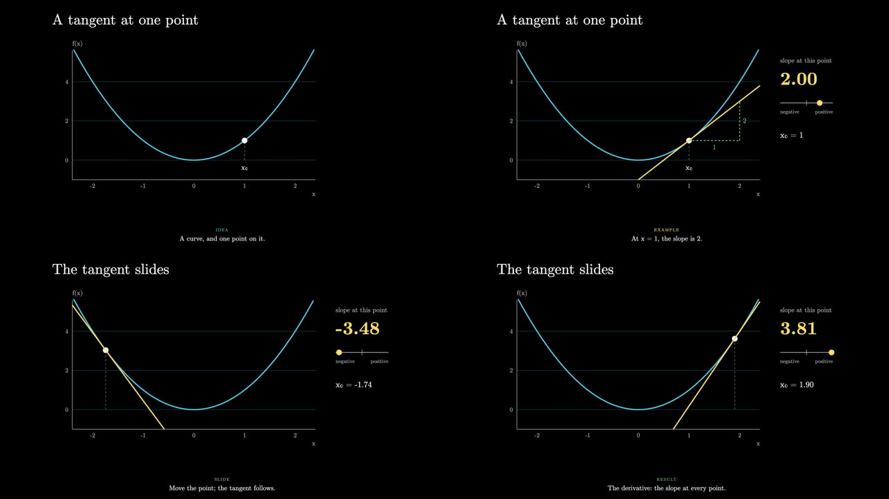
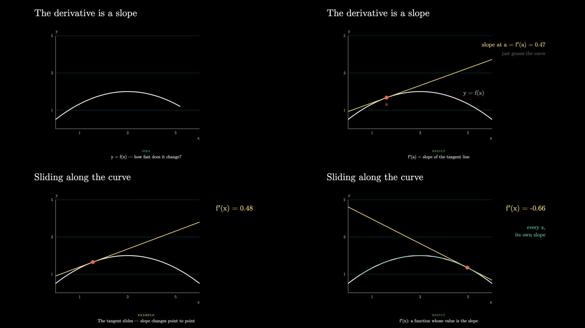
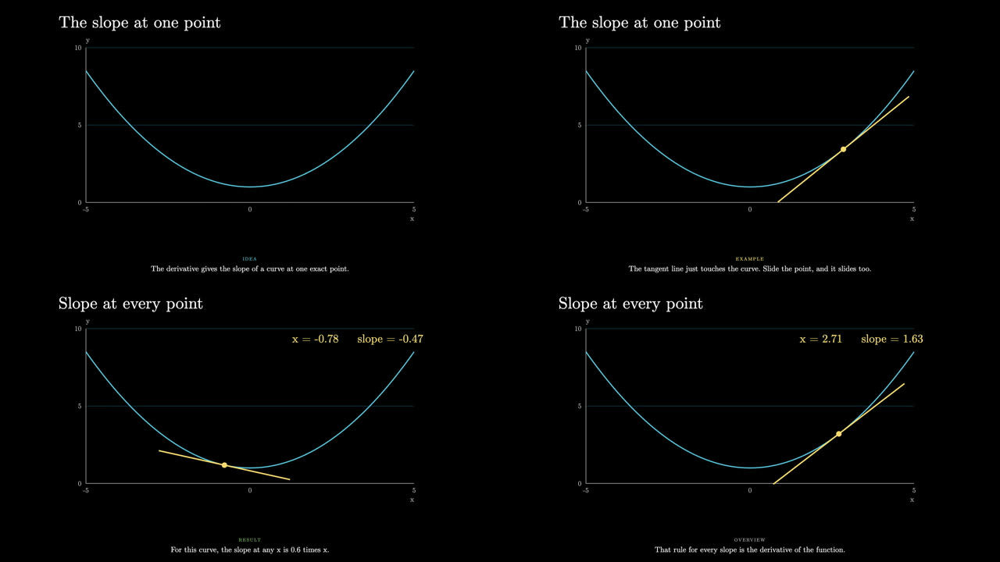
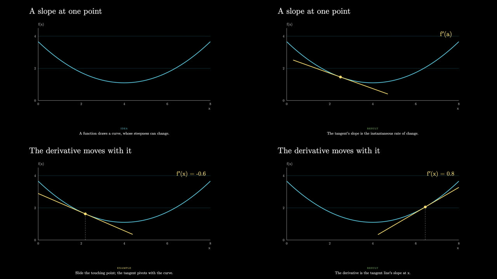

# eigencast

Narrated, Manim-style explainer videos (black background, Computer Modern text, AI voice-over), made on demand by whatever coding agent you already use.



## Why this exists

As the abundance of knowledge, and the tools that make it easy to reach, become more widely available, the question becomes how that abundance can support what people want to learn and understand. A lot of us have watched videos from 3Blue1Brown and The Organic Chemistry Tutor, but getting a specific topic explained on demand, the way they explain things in their videos, used to be hard. With this tool and any agent you already use, it becomes much easier.

You ask for a topic. The agent writes a script and the drawing code, eigencast records the narration with a local AI voice, and you get a 1920×1080 mp4 back. It runs on your machine, and it works with Claude Code, OpenCode, or any agent that can run terminal commands (see the [benchmark](#benchmark-same-prompt-six-models) for how different models do).

eigencast is an independent project. It is not affiliated with 3Blue1Brown or The Organic Chemistry Tutor; it borrows the visual language (Manim's color palette, Computer Modern type), not their content or branding.

## Quick start

Needs [bun](https://bun.sh) and [uv](https://docs.astral.sh/uv/). The voice step needs an Apple Silicon Mac (Qwen3-TTS via mlx); everything else runs anywhere bun does.

```bash
bunx eigencast init my-videos
```

```bash
cd my-videos && bunx eigencast doctor
```

Then open the folder in your agent and ask, for example: *"Make a 40 second video explaining what a derivative is."*

`init` creates a project folder with `eigencast.json`, a `package.json`, `AGENTS.md`, and the agent instructions in `.claude/skills/eigencast/SKILL.md`. Your videos live in that folder, not inside the package.

### Which agents

- **Claude Code**: open the project folder and ask. The skill loads from `.claude/skills/`.
- **OpenCode**: reads the same `.claude/skills/` folder and `AGENTS.md`, with no extra setup. Works with any model OpenCode can reach.
- **Anything else**: point it at `AGENTS.md`.

## How a video is made

A video is a list of **scenes** (chapters, each with its own picture). Each scene has **beats**: one sentence of narration plus what moves on screen while it is said. Beat ids look like `s1b2` (scene 1, beat 2).

Each video is two files the agent writes:

- `videos/<slug>/script.json`: what the narrator says, one entry per beat.
- `videos/<slug>/draw.js`: the scenes, their beats and captions, and a `draw(t, d)` function per scene that paints the moment `t` on a canvas.

Then:

1. **Voice**: `eigencast voice <slug>` records one clip per beat and writes down each clip's length. Unchanged beats are skipped.
2. **Timeline**: each beat lasts as long as its recording plus half a second. The animation inside a beat is stretched to fit, so the picture never runs ahead of the narrator.
3. **Frames**: Remotion opens Chrome and draws the video one frame at a time.
4. **Encode**: Remotion's bundled ffmpeg joins the frames and the clips into an mp4.

## Commands

| Command | What it does |
|---|---|
| `eigencast init [folder]` | Create a project |
| `eigencast new <slug>` | Add a video from the starter template |
| `eigencast check <slug> [--listen]` | Find mistakes before rendering (`--listen` transcribes clips and flags garbled ones) |
| `eigencast voice <slug> [--force] [--only s1b2]` | Record narration (only changed sentences) |
| `eigencast info <slug>` | List beats with their frames and lengths |
| `eigencast still <slug> --beat s1b2` | Render one frame to a PNG |
| `eigencast render <slug> [--concurrency N]` | Render the mp4 (1 Chrome tab by default; more was slower and heavier in testing) |
| `eigencast preview` | Open Remotion Studio to scrub through videos |
| `eigencast doctor` | Check the setup |

Add `--json` to any command for machine-readable output. Commands exit non-zero on failure and say what to do next.

## How the code is structured

Two packages in one repo: the CLI and video engine in TypeScript (run by bun), and the voice step in Python (run by uv, because the TTS model only exists there). Each module has one job and knows as little as possible about the others.

```
script.json ─► voice (Python) ─► audio/*.wav + timing.json
                                            │
draw.js ──────────────────────────► timeline ─► stage ◄── draw kit
                                                   │
                                                render ─► out/<slug>.mp4
```

| Path | Module | Job |
|---|---|---|
| `python/eigencast_voice/voice.py` | voice | Text in, audio out. Backends are swappable; today Qwen3-TTS via mlx-audio. Knows nothing about videos. |
| `python/eigencast_voice/narrate.py` | narrate | Records every beat, skips beats whose words and voice settings are unchanged (by fingerprint), writes `timing.json`. |
| `python/eigencast_voice/listen.py` | listen | Transcribes clips back to text and flags ones that don't match the script. |
| `src/voice/` | voice bridge | Runs the Python package through uv from the CLI. |
| `src/timeline/` | timeline | Recording lengths → how many frames each beat gets; maps any frame back to its beat and scene time. |
| `src/stage/` | stage | Draws one frame in React/Remotion: the canvas, the caption, and where each clip plays. Waits for fonts before the first frame. |
| `src/draw/` | draw kit | What agents write scenes with: `defineVideo`, `text`, `plot`, `axes`, `curve`, `arrow`, `fade`, seeded `rng`. |
| `src/theme/` | theme | Manim's palette and the Computer Modern font stack. |
| `src/render/` | render | Generates the Remotion entry for a project, bundles it, renders stills and mp4s, opens Studio. |
| `src/cli/` | cli | The commands above; thin wrappers over the modules. |
| `src/project.ts` | project | Finds the project folder (`eigencast.json`) and its videos. |
| `skills/eigencast/SKILL.md` | skill | The instructions agents follow: workflow, file formats, the draw kit, and the rules every frame must obey. |
| `templates/` | templates | The starter video and `AGENTS.md` that `init` and `new` copy. |
| `examples/lineage/` | example | A full 6.8-minute video on how ML models evolved, each one's score, loss, wall and fix. |
| `tests/` | tests | End-to-end: packs the package, installs it in a fresh folder, and drives it only through the CLI. |

Rules the engine relies on: every frame is a pure function of its frame number (no `Math.random`, clocks or timers, which `check` flags), and colors come only from the Manim palette.

## Benchmark: same prompt, six models

Each model got the same prompt in a fresh project with only the eigencast skill to go on. No other instructions, no human help, one run each:

> Make a short narrated explainer video (about 30 to 45 seconds, 2 scenes) explaining what the derivative of a function means: the slope of the tangent line, shown as a tangent line sliding along a curve. Use the eigencast tool set up in this folder. I approve the script in advance, so don't stop to ask. Record the narration, check a few stills, and render the final mp4. Tell me the path of the mp4 when done.

Every run produced a narrated mp4 with correct math (each slope readout matches the function in its code). Judge the explanations yourself: each folder has the video, the script, and the drawing code.

| Model | Harness | Video | Agent time | Frames |
|---|---|---|---|---|
| Gemini 4 Argon | OpenCode (OpenCode Go) | [38 s](docs/benchmark/gemini-4-argon/video.mp4) · [script](docs/benchmark/gemini-4-argon/script.json) · [draw.js](docs/benchmark/gemini-4-argon/draw.js) | 9 min |  |
| Claude Opus 5.5 | Claude Code | [46 s](docs/benchmark/claude-opus-5-5/video.mp4) · [script](docs/benchmark/claude-opus-5-5/script.json) · [draw.js](docs/benchmark/claude-opus-5-5/draw.js) | 5 min |  |
| DeepSeek v4.1 Flash | OpenCode (OpenCode Go) | [40 s](docs/benchmark/deepseek-v4-1-flash/video.mp4) · [script](docs/benchmark/deepseek-v4-1-flash/script.json) · [draw.js](docs/benchmark/deepseek-v4-1-flash/draw.js) | 28 min |  |
| GLM 5.3 Flash | OpenCode (OpenCode Go) | [33 s](docs/benchmark/glm-5-3-flash/video.mp4) · [script](docs/benchmark/glm-5-3-flash/script.json) · [draw.js](docs/benchmark/glm-5-3-flash/draw.js) | 3 min |  |
| Claude Haiku 5.5 | OpenCode (OpenCode Go) | [33 s](docs/benchmark/claude-haiku-5-5/video.mp4) · [script](docs/benchmark/claude-haiku-5-5/script.json) · [draw.js](docs/benchmark/claude-haiku-5-5/draw.js) | not timed |  |
| GPT 6 Luna (high) | OpenCode (OpenCode Go) | [38 s](docs/benchmark/gpt-6-luna-high/video.mp4) · [script](docs/benchmark/gpt-6-luna-high/script.json) · [draw.js](docs/benchmark/gpt-6-luna-high/draw.js) | 3 min |  |

What stood out:

- **Gemini 4 Argon** explained it best: a rise-over-run triangle and a definition panel, then the derivative curve f′(x) traced live beside the sliding tangent. It also caught and fixed text overflowing a box before rendering.
- **Claude Opus 5.5** showed why the tangent is a limit: a line through two points shrinks into the tangent, then the flat points are circled.
- **DeepSeek v4.1 Flash** was polished but slow: most of its time went into re-recording one clip that `check --listen` flagged as garbled.
- **GLM 5.3 Flash** and **Claude Haiku 5.5** were fast and correct, with simpler visuals.
- **GPT 6 Luna (high)** was the plainest: a tangent sliding along a parabola with a slope readout.

How it was run: one model at a time on a MacBook Air M4 (16 GB), eigencast 0.1.0. Agent time includes recording narration and rendering. One run per model, so treat it as a sample, not a ranking; results will vary between runs.

## Fonts and license

Code: MIT (see `LICENSE`). Fonts: CMU Serif, SIL Open Font License (`fonts/OFL.txt`).
